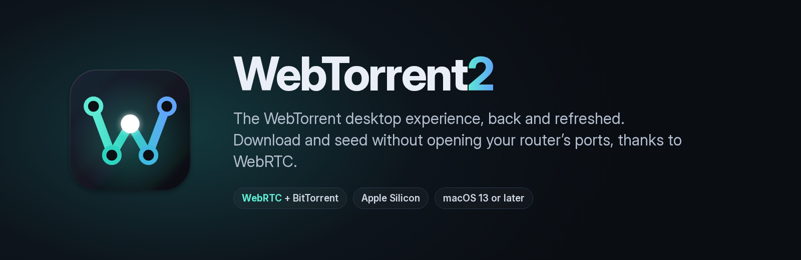
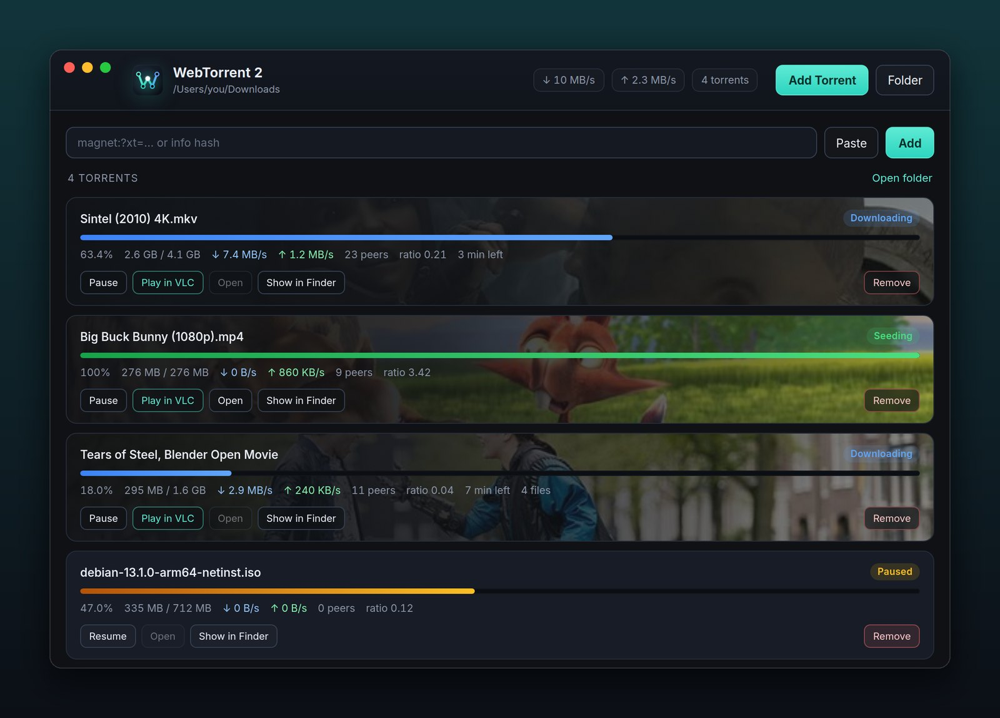
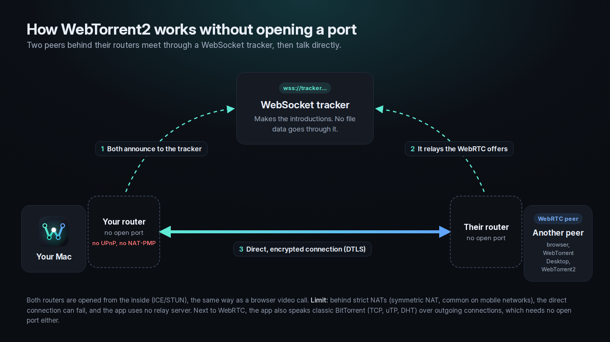

<p align="center">
  
</p>

# WebTorrent2

WebTorrent2 brings back the WebTorrent desktop experience, refreshed. Download and
seed without opening your router's ports, thanks to WebRTC.

It is a torrent app for Mac that speaks both classic BitTorrent and WebRTC, so it
trades with the usual clients and with WebTorrent peers running in a web browser,
from behind the home router you already have.

**[Download for Mac](../../releases/latest)** (Apple Silicon, macOS 13 or later)

<p align="center">
  
</p>

## What you get

- **Seeding that works behind your router.** Two peers that both sit behind home
  routers can still connect over WebRTC, so you share without forwarding a port or
  opening your router's settings.
- **A look at every video.** Each card shows a frame of the film, taken from the
  torrent's own artwork or from the clearest of three moments in the video. Hover
  the card and the video plays, muted, while it downloads.
- **Play in VLC, mid-download.** One click streams the file to VLC in playback
  order, or opens it from disk once it is complete.
- **Drop a torrent anywhere.** `.torrent` files and magnet links work on the window,
  the Dock icon and the menu bar icon.
- **Keeps sharing in the background.** Close the window and WebTorrent2 keeps
  seeding from the menu bar, then picks up where it left off at the next launch.

## Privacy, especially when you seed

Seeding is when a torrent client is most exposed: your Mac stays announced as a
source for as long as you share. WebTorrent2 keeps that exposure small.

- **Your router stays closed.** Classic clients usually ask you to forward a port so
  peers can reach you, which leaves an open door on your public address that anyone
  scanning the internet can find. WebTorrent2 never opens one. UPnP and NAT-PMP are
  off, and WebRTC peers reach you through connections your Mac starts itself.
- **Encrypted links.** Every WebRTC connection runs inside DTLS, and announces to
  WebSocket trackers travel over TLS. On those links your internet provider sees
  encrypted traffic and cannot read which torrent you are sharing. Connections to
  classic clients try BitTorrent's protocol encryption, a lighter obfuscation layer,
  and fall back to plain text when the other side lacks it. The DHT and UDP
  trackers are always in plain text.
- **Made for VPNs without port forwarding.** Many VPN providers have stopped
  forwarding ports ([Mullvad removed it in July 2023](https://mullvad.net/en/blog/2023/5/29/removing-the-support-for-forwarded-ports)),
  which leaves a classic client unable to accept incoming peers. WebRTC peers can
  still reach you whenever the VPN's network allows it.
- **No tracking.** WebTorrent2 has no telemetry and needs no account, and video
  previews are made on your Mac.

### Use a VPN anyway

A torrent swarm is public. Every peer, every tracker and the public STUN servers
that WebRTC relies on see your IP address, and seeding keeps it on display for as
long as you share. WebRTC can also show peers your local network address, such as
`192.168.1.20`. Before you open WebTorrent2, connect a VPN that allows P2P traffic,
for the whole Mac rather than for some apps, with its kill switch on. Peers then see
the VPN's address instead of your home one.

## How seeding without ports works

<p align="center">
  
</p>

Two peers behind their routers meet through a WebSocket tracker, swap connection
offers, then open a direct link from both sides, the same way a video call works in
a browser. WebTorrent2 adds three WebSocket trackers to every public torrent so this
works with any of them, and leaves private torrents untouched.

One limit: behind strict NATs (symmetric NAT, common on mobile networks) the direct
link can fail, and the app uses no relay server.

## Install

1. Download the DMG and `SHA256SUMS.txt` from the [latest release](../../releases/latest),
   then check the fingerprint: `shasum -a 256 -c SHA256SUMS.txt --ignore-missing`
2. Drag **WebTorrent 2** into Applications.
3. The app is signed but not notarized by Apple, so macOS blocks the first launch.
   On macOS 15 and later, go to **System Settings > Privacy & Security > Open
   Anyway**. On macOS 13 and 14, right-click the app and choose **Open**.

Play in VLC needs [VLC](https://www.videolan.org/vlc/). New releases follow the
webtorrent engine on their own: once an engine update is three days old, it is
installed, tested and launched on a Mac before a new version is published here.

## Built to be safe

Torrents come from strangers, and WebTorrent2 treats them that way. A torrent cannot
reach your local network or write outside its own folder, and the **Open** button
never launches a script or an app that came from one. Every build verifies the npm
signatures of its dependencies, runs the tests and launches the signed app on a Mac
before anything is published. The full audit is in [SECURITY_AUDIT.md](SECURITY_AUDIT.md).

## Build from source

Requires Node 22 or later.

```bash
npm install
npm start
npm test
```

---

WebTorrent2 is released under the [MIT license](LICENSE). Film stills in the screenshot: *Big Buck Bunny*, *Sintel* and *Tears of Steel*,
© Blender Foundation, [CC BY 3.0](https://creativecommons.org/licenses/by/3.0/),
via Wikimedia Commons.
